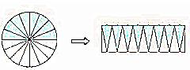

# Mathematics (Grade 6)

**ID**: afa6b4fe
**难度**: medium
**题型**: multiple_choice

## 题目
把一张圆形纸片剪拼成一个近似的长方形，这个长方形的长是12.56厘米，圆的面积是（   ）平方厘米。

$\begin{description}
\item A．25.12\item B．50.24\item C．100.48\item D．200.96
\end{description}$

## 解答

**答案**: B

1. Step1:把圆形纸片剪拼成近似长方形时，长方形的长近似为圆周长的一半。已知长方形长是12.56厘米，根据圆的周长公式C = 2πr，可得圆周长的一半为πr，即πr = 12.56厘米。
2. Step2:由πr = 12.56厘米，π取3.14，可计算出圆的半径r，r = 12.56÷3.14 = 4厘米。
3. Step3:根据圆的面积公式S = πr²，把r = 4厘米，π = 3.14代入，可得S = 3.14×4² = 3.14×16 = 50.24平方厘米，所以答案选B。

## 知识点

**知识点**:
  - 

---
