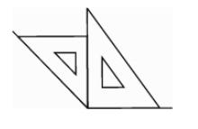

# Mathematics (Grade 6)

**ID**: b03e29bb
**难度**: medium
**题型**: multiple_choice

## 题目
如图用一副三角板拼成的这个角是（）。

A. 120°  
B. 135°
C. 75°
D. 150°

## 解答

**答案**: B

1. Step1:观察图示，明确是用一副三角板拼成的角
2. Step2:根据解题方法提示，确定该角是由45°与90°的角组成
3. Step3:按照角的计算方法，计算45°+90°的结果为135°
4. Step4:对比选项，得出答案是B

## 知识点

**知识点**:
  - 角的度量

---
