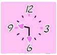

# Mathematics (Grade 6)

**ID**: b3030974
**难度**: medium
**题型**: multiple_choice

## 题目
下面的钟表显示的是（   ） 。

$\begin{description}
\item A．8时半\item B．8时\item C．9时\item D．9时半
\end{description}$

## 解答

**答案**: D

1. Step1:观察钟表，时针指向8和9的中间，分针指向6。
2. Step2:因为分针指向6表示30分，即时针过了8，还没到9，此时是8时半。
3. Step3:对比选项，8时半对应的是D选项。

## 知识点

**知识点**:
  - 小学数学;数与代数;常见的量;时间单位及换算;认识钟面指针及时间读法;半点时间与钟面指针的位置

---
