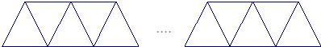

# Mathematics (Grade 6)

**ID**: b40de344
**难度**: medium
**题型**: multiple_choice

## 题目
用3根小棒可以摆一个三角形，按下面的方式摆下去，摆100个三角形需要（  ）根小棒．

A．3×100
B．3×50+50+1
C．2×99+1
D．3×100-100

## 解答

**答案**: B

1. Step1:分析可知，摆1个三角形用3根小棒，摆2个三角形时，第2个三角形在第1个的基础上增加2根小棒，即3 + 2 = 5根；摆3个三角形时，第3个三角形在前2个的基础上又增加2根小棒，即3 + 2×2 = 7根，以此类推，可得出规律：摆n个三角形需要小棒的数量为3 + (n - 1)×2根。
2. Step2:当n = 100时，代入上述规律式子，可得摆100个三角形需要小棒的数量为3 + (100 - 1)×2 = 3 + 99×2 = 3 + 198 = 201根。
3. Step3:分别计算各选项的值。选项A：3×100 = 300根；选项B：3×50 + 50 + 1 = 150 + 50 + 1 = 201根；选项C：2×99 + 1 = 198 + 1 = 199根；选项D：3×100 - 100 = 300 - 100 = 200根。
4. Step4:对比计算结果，发现与摆100个三角形需要201根小棒结果相等的是选项B。
5. Step5:所以答案是B。

## 知识点

**知识点**:
  - 通过操作实验探索规律．

---
