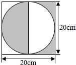

# Mathematics (Grade 6)

**ID**: b467f5cf
**难度**: medium
**题型**: multiple_choice

## 题目
如图中，阴影部分的面积是(  )平方厘米．

A．400
B．200
C．314
D．157

## 解答

**答案**: B

1. Step1:根据图中阴影部分的半圆和空白部分半圆的面积相等，得出阴影部分的面积是正方形面积的一半
2. Step2:已知正方形边长为20厘米，根据正方形面积公式S=a×a（a为边长），可得正方形面积为20×20 = 400平方厘米
3. Step3:计算阴影部分面积，即400÷2 = 200平方厘米

## 知识点

**知识点**:
  - 组合图形的面积．

---
