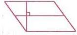

# Mathematics (Grade 6)

**ID**: b5ccaf99
**难度**: medium
**题型**: multiple_choice

## 题目
两条垂直线段将平行四边形分成四部分（如右图），那么图中梯形有（    ）个

   A．3
   B．4
   C．5
   D．6

## 解答

**答案**: B

1. Step1:观察图形，确定图形由上面小平行四边形、下面小平行四边形和大平行四边形组成
2. Step2:数上面小平行四边形中梯形的数量，得到有2个梯形
3. Step3:数下面小平行四边形中梯形的数量，得到有1个梯形
4. Step4:数大平行四边形中梯形的数量，得到有1个梯形
5. Step5:将各部分梯形数量相加，2 + 1 + 1 = 4个梯形
6. Step6:对比选项，选择答案B

## 知识点

**知识点**:
  - 分类专项复习卷（七）
--

---
