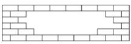

# Mathematics (Grade 6)

**ID**: b603dd0b
**难度**: medium
**题型**: multiple_choice

## 题目
下面的墙缺了（   ）块砖。

$\begin{description}
\item A．20\item B．21\item C．22
\end{description}$

## 解答

**答案**: B

1. Step1:观察墙面，确定每行砖的数量和排列规律
2. Step2:从墙面顶部开始，逐行对比完整行和缺失部分，数出每行缺失砖的数量
3. Step3:将每行缺失砖的数量相加，得到总共缺失砖的数量
4. Step4:将计算结果与选项进行对比，得出答案为B

## 知识点

**知识点**:
  - 

---
