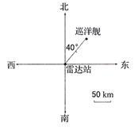

# Mathematics (Grade 6)

**ID**: b60f2550
**难度**: medium
**题型**: multiple_choice

## 题目
如下图所示，巡洋舰在雷达站的（ ）处。

$\begin{description}
\item A．北偏东40°方向50km\item B．北偏西40°方向50km\item C．北偏东40°方向100km
\end{description}$

## 解答

**答案**: C

1. Step1:观察图可知，巡洋舰在雷达站的北偏东方向
2. Step2:从图中角度标识可确定角度为40°
3. Step3:根据图中比例尺，一个单位长度代表50km，巡洋舰到雷达站有2个单位长度，所以距离为50×2 = 100km
4. Step4:综上，巡洋舰在雷达站的北偏东40°方向100km处，答案选C

## 知识点

**知识点**:
  - 小学数学;图形与几何;位置与方向;根据方向、角度和距离确定物体的位置

---
