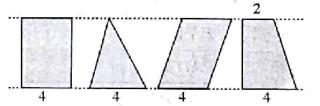

# Mathematics (Grade 6)

**ID**: b71a5a05
**难度**: medium
**题型**: multiple_choice

## 题目
两条平行线之间有四个图形（如图），面积关系是$2:3$的两个图形是（  ）。

A．三角形与长方形
B．平行四边形与梯形
C．梯形与长方形
D．三角形与梯形

## 解答

**答案**: D

1. Step1:设两条平行线间的距离为h。
2. Step2:计算长方形面积，根据长方形面积公式S = 长×宽，可得长方形面积S1 = 4h。
3. Step3:计算三角形面积，根据三角形面积公式S = 底×高÷2，可得三角形面积S2 = 4h÷2 = 2h。
4. Step4:计算平行四边形面积，根据平行四边形面积公式S = 底×高，可得平行四边形面积S3 = 4h。
5. Step5:计算梯形面积，根据梯形面积公式S=(上底 + 下底)×高÷2，可得梯形面积S4=(2 + 4)h÷2 = 3h。
6. Step6:比较各图形面积关系，发现三角形面积与梯形面积比为2h:3h = 2:3。
7. Step7:得出面积关系是2:3的两个图形是三角形与梯形，答案为D。

## 知识点

**知识点**:
  - 小学数学;数与代数;比和比例;比;比值与化简比;图形与几何;平面图形;平行四边形;平行四边形的面积;梯形的特征及分类;梯形的面积;三角形;三角形的面积

---
