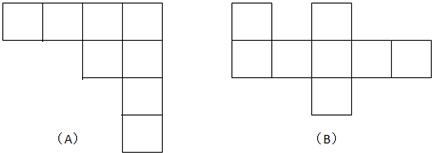

# Mathematics (Grade 6)

**ID**: b76c1f12
**难度**: medium
**题型**: multiple_choice

## 题目
对于下面的两个图形，说法正确的是（  ）

A．A图的周长大，面积两个图形一样
B．B图的周长大，面积两个图形一样
C．A图的面积大，周长两个图形一样
D．B图的面积大，周长两个图形一样

## 解答

**答案**: B

1. Step1:根据解析2，将图形A通过平移，其周长等于边长为4的正方形周长，根据正方形周长公式C = 4a（a为边长），可得图形A周长为4×4 = 16。
2. Step2:根据解析2，图形B的周长等于长5宽3的长方形周长+2，根据长方形周长公式C = (a + b)×2（a为长，b为宽），先算出长方形周长为(5 + 3)×2 = 16，再加上2，即图形B周长为16 + 2 = 18。
3. Step3:分别数两个图形中小正方形的个数，可知图形A和图形B都由8个小正方形组成，所以它们面积一样大。
4. Step4:比较图形A和图形B的周长，16 < 18，即B图周长大，且两个图形面积一样，所以答案选B。

## 知识点

**知识点**:
  - 巧算周长；面积及面积的大小比较．

---
