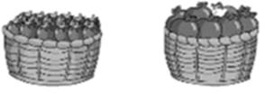

# Mathematics (Grade 6)

**ID**: b7bef82d
**难度**: medium
**题型**: multiple_choice

## 题目
草莓有80个，苹果可能有多少个？（   ）

草莓            苹果
$\begin{description}
\item A．20个\item B．65个\item C．90个
\end{description}$

## 解答

**答案**: A

1. Step1:观察图片可知苹果的数量比草莓少
2. Step2:分析选项，A选项20个比80个少很多，B选项65个比80个少但少得不多，C选项90个比80个多
3. Step3:根据苹果数量比草莓少这一条件，判断只有A选项符合

## 知识点

**知识点**:
  - 小学数学;数与代数;数的认识;整数的认识;100以内数的认识;100以内数的估计

---
