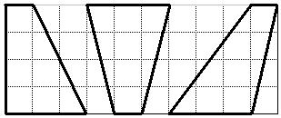

# Mathematics (Grade 6)

**ID**: bbc69625
**难度**: medium
**题型**: multiple_choice

## 题目
图中三个梯形的面积相等．(     )．（判断对错）

## 解答

**答案**: √

1. Step1:设一个格子的长度是1
2. Step2:根据梯形面积公式，计算第一个梯形面积为（1+3）×4÷2=4×4÷2=8
3. Step3:根据梯形面积公式，计算第二个梯形面积为（1+3）×4÷2=4×4÷2=8
4. Step4:根据梯形面积公式，计算第三个梯形面积为（1+3）×4÷2=4×4÷2=8
5. Step5:比较三个梯形面积，发现都为8，得出三个梯形面积相等，判断原题说法正确，答案为√

## 知识点

**知识点**:
  - 梯形的面积

---
