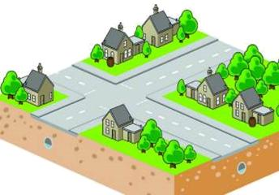

# Mathematics (Grade 6)

**ID**: bd4e04df
**难度**: medium
**题型**: multiple_choice

## 题目
数一数图中有（  ）套房子。

$\begin{description}
\item A．4\item B．5\item C．6\item D．7
\end{description}$

## 解答

**答案**: C

1. Step1:观察图片，发现图中左上角有1套房子
2. Step2:看到图中右上角有2套房子
3. Step3:注意到图中左下角有1套房子
4. Step4:发现图中右下角有2套房子
5. Step5:将各处房子数量相加，1 + 2 + 1 + 2 = 6套
6. Step6:对比选项，得出答案为C

## 知识点

**知识点**:
  - 小学数学;数与代数;数的认识;整数的认识

---
