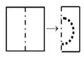

# Mathematics (Grade 6)

**ID**: c1722298
**难度**: medium
**题型**: multiple_choice

## 题目
像这样先折后剪会得到一个（   ）。

A．正方形
B．长方形
C．圆形

## 解答

**答案**: C

1. Step1:观察图形可知是对一张纸先进行折叠然后裁剪的操作
2. Step2:分析选项A，正方形有四条边且四个角为直角，通过这种先折后剪的方式很难得到正方形
3. Step3:分析选项B，长方形有四条边且对边相等，四个角为直角，这种先折后剪的方式也不易得到长方形
4. Step4:分析选项C，当以折叠点为圆心进行裁剪时，有可能得到圆形，与答案相符

## 知识点

**知识点**:
  - 

---
