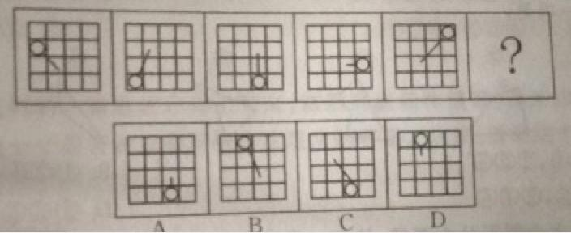

# Mathematics (Grade 6)

**ID**: c1e71c80
**难度**: medium
**题型**: multiple_choice

## 题目
从所给四个选项中，选择最合适的一个填入问号处，使之呈现一定的规律性：

## 解答

**答案**: C

1. Step1:观察图形，确定需要分析圆圈和直线的变化规律
2. Step2:先看圆圈位置，发现其是逆时针旋转2个方格
3. Step3:再看直线朝向，明确其是按照逆时针旋转90°、45°依次进行
4. Step4:根据上述规律，对问号处图形进行推断，得出是C图

## 知识点

**知识点**:
  - --

---
