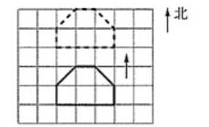

# Mathematics (Grade 6)

**ID**: c1eebc9b
**难度**: medium
**题型**: multiple_choice

## 题目
右面方格中的图形（    ）.
 A.向南平移1格
 B.向北平移1格
 C.向南平移3格
 D.向北平移3格

## 解答

**答案**: D

1. Step1:观察方格中的图形，确定原始图形和移动后的图形
2. Step2:根据图中所给的方向标识，明确上为北方向
3. Step3:对比原始图形和移动后的图形，发现图形是向上移动
4. Step4:数出图形向上移动的格数为3格
5. Step5:因为上为北方向，向上移动即向北移动，所以图形是向北平移3格
6. Step6:对比选项，得出答案为D

## 知识点

**知识点**:
  - 图形的运动;

---
