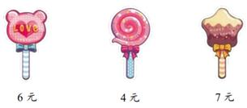

# Mathematics (Grade 6)

**ID**: c24a1ee4
**难度**: medium
**题型**: multiple_choice

## 题目
苗苗买其中两根不同的棒棒糖,最多要花_______元．

A．10
B．11
C．13

## 解答

**答案**: C

1. Step1:明确目标是找出买两根不同棒棒糖花费最多的金额
2. Step2:观察三种棒棒糖的价格分别为6元、4元、7元
3. Step3:为了花费最多，应选择价格较高的两根棒棒糖，即6元和7元的
4. Step4:计算这两根棒棒糖的总价为6 + 7 = 13元
5. Step5:对比选项，发现13元对应的是C选项

## 知识点

**知识点**:
  - 小学数学;数与代数;应用题;简单应用题;整数简单应用题

---
