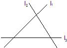

# Mathematics (Grade 6)

**ID**: c26d5379
**难度**: medium
**题型**: multiple_choice

## 题目
图中对顶角有(  )对．

A．3
B．4
C．5
D．6

## 解答

**答案**: D

1. Step1:明确对顶角的定义，即如果一个角的两边分别是另一个角两边的反向延长线，且这两个角有公共顶点，那么这两个角是对顶角
2. Step2:观察图形，确定直线$L_{1}$、$L_{2}$、$L_{3}$的交点个数为3个
3. Step3:根据每一个交点处有2对对顶角，计算对顶角的总数为3×2=6对
4. Step4:对比选项，得出答案为D

## 知识点

**知识点**:
  - 角的概念及其分类．

---
