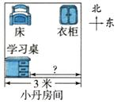

# Mathematics (Grade 6)

**ID**: c4558597
**难度**: medium
**题型**: multiple_choice

## 题目
爸爸为小丹买了一个学习桌，桌面长10分米，宽7分米。按图所示摆放，她的学习桌离东面墙的距离还剩（   ）。

A．2分米
B．20分米
C．23分米
D．30分米

## 解答

**答案**: B

1. Step1:先将图中房间长度的单位3米换算成分米，因为1米 = 10分米，所以3米 = 30分米。
2. Step2:已知学习桌桌面长10分米，用房间的长度30分米减去学习桌的长度10分米，即30 - 10 = 20分米，得到学习桌离东面墙的距离。
3. Step3:对比选项，发现20分米符合选项B。

## 知识点

**知识点**:
  - 小学数学;数与代数;数的运算;整数的四则运算

---
