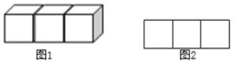

# Mathematics (Grade 6)

**ID**: c46b7896
**难度**: medium
**题型**: multiple_choice

## 题目
观察这个图1物体，从（ ）看到的图形和从图2看到的是一样的．

A．左面和右面
B．右面和前面
C．前面和上面
D．上面和左面

## 解答

**答案**: C

1. Step1:观察图1物体，思考从不同方向观察可能看到的图形。
2. Step2:分析从左面看，图1物体的图形特征与图2不同。
3. Step3:分析从右面看，图1物体的图形特征与图2不同。
4. Step4:分析从前面看，图1物体呈现的图形与图2一致。
5. Step5:分析从上面看，图1物体呈现的图形与图2一致。
6. Step6:对比选项，得出前面和上面看到的图形和图2一样，所以选C。

## 知识点

**知识点**:
  - 

---
