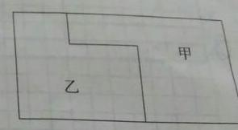

# Mathematics (Grade 6)

**ID**: c63aa9ce
**难度**: medium
**题型**: multiple_choice

## 题目
甲与乙这两个图形相比较（如图）（    ）
 A.周长相同，面积相同
 B.周长相同，面积不同
 C.周长不同，面积相同

 甲
 乙

## 解答

**答案**: B

1. Step1:观察图形可知甲乙两幅图相邻部分的折线是公共的
2. Step2:根据相邻部分折线是公共的，可得甲和乙的周长相同
3. Step3:通过观察图形直观判断出甲的面积大于乙的面积
4. Step4:综合周长和面积的比较结果，得出答案为B

## 知识点

**知识点**:
  - 

---
