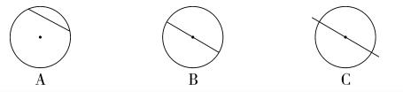

# Mathematics (Grade 6)

**ID**: c65bb777
**难度**: medium
**题型**: multiple_choice

## 题目
下图中的线段是圆的直径的是（）。

## 解答

**答案**: B

1. Step1:明确圆的直径的定义为两端都在圆上且经过圆心的线段。
2. Step2:观察选项A，其中线段两端在圆上但未经过圆心，不是直径。
3. Step3:观察选项B，其中线段两端在圆上且经过圆心，符合直径定义。
4. Step4:观察选项C，其中线段有一端不在圆上，不是直径。
5. Step5:综上，答案是B。

## 知识点

**知识点**:
  - 圆的认识

---
