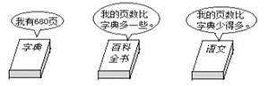

# Mathematics (Grade 6)

**ID**: c9789d5d
**难度**: medium
**题型**: multiple_choice

## 题目
语文书有多少页？百科全书有多少页？（   ）

A．158页；780页
B．158页；650页
C．780页；1200页

## 解答

**答案**: A

1. Step1:已知字典有680页，百科书的页数比字典多一些，语文书的页数比字典少得多。
2. Step2:分析选项A，158页比680页少得多符合语文书页数特点，780页比680页多一些符合百科书页数特点。
3. Step3:分析选项B，650页比680页少一些，不符合百科书比字典多一些的条件。
4. Step4:分析选项C，780页比680页多一些符合百科书页数特点，但1200页比680页多很多，不符合语文书比字典少得多的条件。
5. Step5:综上，答案是A。

## 知识点

**知识点**:
  - 小学数学;数与代数;数的认识;整数的认识;100以内数的认识;数的相对大小关系;万以内数的认识;1000以内数的估计;1000以内数的比大小

---
