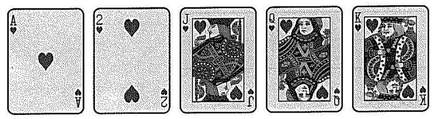

# Mathematics (Grade 6)

**ID**: cad7836a
**难度**: medium
**题型**: multiple_choice

## 题目

   从5张牌中，任意抽取2张，共有（  ）种抽法
   A．20
   B．10
   C．5

## 解答

**答案**: B

1. Step1:明确问题是求从5张牌中任意抽取2张的抽法数量
2. Step2:根据解析2的思路，将所有抽取情况列举出来，即A2、AJ、AQ、AK、2J、2Q、2K、JQ、JK、QK
3. Step3:数出列举出的抽法共有10种
4. Step4:对比选项，发现B选项为10，所以答案是B

## 知识点

**知识点**:
  - 测试卷
--

---
