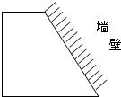

# Mathematics (Grade 6)

**ID**: cc50d6f4
**难度**: medium
**题型**: multiple_choice

## 题目
如图，用篱笆围成一块梯形菜地，它的一边是利用了屋子的墙壁，篱笆长50米，梯形高是10米，这块梯形菜地的面积为（  ）平方米．
A．200
B．300
C．400
D．500

## 解答

**答案**: A

1. Step1:明确篱笆长为50米，梯形高为10米，且一边利用墙壁，所以上下底的和等于篱笆长减去梯形的高，即50 - 10 = 40米
2. Step2:根据梯形面积公式S =（a + b）h÷2，其中a + b为上下底的和是40米，h为高是10米，可得面积为40×10÷2
3. Step3:计算40×10÷2 = 400÷2 = 200平方米
4. Step4:对比选项，答案为A

## 知识点

**知识点**:
  - 梯形的面积．

---
