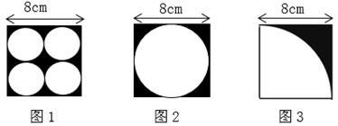

# Mathematics (Grade 6)

**ID**: cc81ff26
**难度**: medium
**题型**: multiple_choice

## 题目
如下图，图1、图2图3阴影部分面积比较(    )。

A．图1阴影部分面积最大；
B．图2阴影部分面积最大；
C．图3阴影部分面积最大；
D．图1、图2、图3阴影部分面积一样大。

## 解答

**答案**: D

1. Step1:计算图1中正方形的面积，边长为8cm，根据正方形面积公式S=a²（a为边长），可得S=8×8 = 64cm²。
2. Step2:计算图1中4个圆的面积，每个圆的直径为8÷2 = 4cm，半径为4÷2 = 2cm，一个圆的面积根据圆的面积公式S=πr²（r为半径），可得一个圆面积为π×2² = 4πcm²，4个圆的面积为4×4π = 16πcm²，那么图1阴影部分面积为64 - 16πcm²。
3. Step3:计算图2中正方形的面积，同样边长为8cm，面积为8×8 = 64cm²。
4. Step4:计算图2中圆的面积，圆的直径为8cm，半径为8÷2 = 4cm，根据圆的面积公式可得圆的面积为π×4² = 16πcm²，那么图2阴影部分面积为64 - 16πcm²。
5. Step5:计算图3中正方形的面积，边长为8cm，面积为8×8 = 64cm²。
6. Step6:计算图3中扇形的面积，扇形为四分之一圆，圆的半径为8cm，根据圆的面积公式可得圆的面积为π×8² = 64πcm²，扇形面积为64π×(1/4)= 16πcm²，那么图3阴影部分面积为64 - 16πcm²。
7. Step7:比较三个图形阴影部分面积，均为64 - 16πcm²，所以图1、图2、图3阴影部分面积一样大，答案选D。

## 知识点

**知识点**:
  - 小学数学;图形与几何

---
