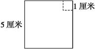

# Mathematics (Grade 6)

**ID**: ce1f00a7
**难度**: medium
**题型**: multiple_choice

## 题目
从边长5厘米的正方形的一个角上剪去一个边长1厘米的小正方形,如图所示,剪后的图形的周长与原正方形的周长相比,(  )。

$\begin{description}
\item A．剪后的图形周长长\item B．原正方形的周长长\item C．周长一样长
\end{description}$

## 解答

**答案**: C

1. Step1:明确原正方形周长的计算方法，原正方形边长为5厘米，根据正方形周长公式C = 4a（C为周长，a为边长），可得原正方形周长为4×5 = 20厘米。
2. Step2:分析剪后的图形的周长，从正方形一个角上剪去一个小正方形后，剪去的两条小正方形的边的长度，又在新图形中露出了同样长度的两条边，所以剪后的图形周长依然是原来正方形四条边的长度之和，即4×5 = 20厘米。
3. Step3:比较剪后的图形周长和原正方形周长，两者均为20厘米，所以周长一样长，答案选C。

## 知识点

**知识点**:
  - 小学数学;图形与几何;平面图形;长方形和正方形;正方形的周长;图形的拼组;平面图形的切拼

---
