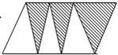

# Mathematics (Grade 6)

**ID**: cea7499f
**难度**: medium
**题型**: multiple_choice

## 题目
如图阴影部分的面积与空白部分的面积相比较，它们（  ）
A．相等
B．不相等
C．无法比较

## 解答

**答案**: A

1. Step1:观察图形可知其为平行四边形，阴影部分是三个三角形，空白部分也是三个三角形
2. Step2:根据三角形面积公式及平行四边形的性质，可得三个阴影三角形的面积和等于平行四边形面积的一半
3. Step3:同理，三个空白三角形的面积和也等于平行四边形面积的一半
4. Step4:因为三个阴影三角形的面积和与三个空白三角形的面积和都等于平行四边形面积的一半，所以它们相等
5. Step5:根据选项，答案为A

## 知识点

**知识点**:
  - 组合图形的面积．

---
