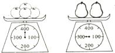

# Mathematics (Grade 6)

**ID**: cf07213a
**难度**: medium
**题型**: multiple_choice

## 题目
如图，一个梨比一个桶子重（  ）

A．100g
B．50g
C．20g
D．200g

## 解答

**答案**: B

1. Step1:根据图中信息，明确四个柚子重400克，两个梨重300克
2. Step2:根据除法的意义，计算一个梨的重量为300÷2 = 150克
3. Step3:根据除法的意义，计算一个柚子的重量为400÷4 = 100克
4. Step4:用一个梨的重量减去一个柚子的重量，即150 - 100 = 50克，得出一个梨比一个柚子重50克

## 知识点

**知识点**:
  - 整数、小数复合应用题．

---
