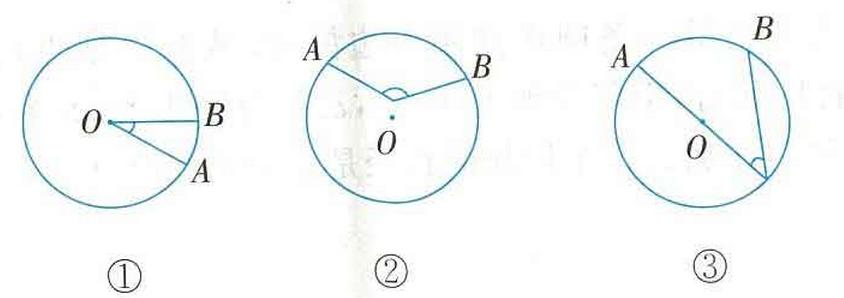

# Mathematics (Grade 6)

**ID**: d123b88f
**难度**: medium
**题型**: multiple_choice

## 题目
下面图形中，（    ）是圆心角．

## 解答

**答案**: ①

1. Step1:明确圆心角的定义为顶点在圆心上，且角的两个端点在圆上的角
2. Step2:观察图①，其角的顶点是圆心O，角的两个端点A、B在圆上，符合圆心角定义
3. Step3:观察图②，其角的顶点不在圆心，不符合圆心角定义
4. Step4:观察图③，其角的顶点不在圆心，不符合圆心角定义
5. Step5:综上，只有图①是圆心角，答案为①

## 知识点

**知识点**:
  - 第五单元达标卷（一）
--

---
