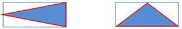

# Mathematics (Grade 6)

**ID**: d6ad1340
**难度**: medium
**题型**: multiple_choice

## 题目
下面是两个面积相等的长方形，图中空白部分面积相比较，（    ）

A．甲>乙
B．甲<乙
C．甲=乙
D．无法确定

## 解答

**答案**: C

1. Step1:观察图形可知，两个长方形面积相等。
2. Step2:因为甲图中空白部分的面积等于长方形面积减去蓝色三角形面积，乙图中空白部分的面积也等于长方形面积减去蓝色三角形面积。
3. Step3:又因为两个长方形面积相等，且两个蓝色三角形的底都是长方形的长，高都是长方形的宽，根据三角形面积公式S = 1/2×底×高，可知两个蓝色三角形面积相等。
4. Step4:所以两个图中空白部分面积相等，答案选C。

## 知识点

**知识点**:
  - 

---
