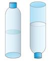

# Mathematics (Grade 6)

**ID**: db85997c
**难度**: medium
**题型**: multiple_choice

## 题目
如下图，一个饮料瓶内饮料的高度是6cm，将这个饮料瓶的瓶盖拧紧倒置放平，空余部分的高度是10cm．已知这个饮料瓶的容积是672mL，则瓶内的饮料有（   ）． 

A.42mL
B.112mL
C.252mL
D.420mL

## 解答

**答案**: C

1. Step1:因为饮料瓶的容积等于饮料的体积加上倒置时空余部分的体积，且饮料瓶正放和倒置时底面积不变，设底面积为S，根据圆柱体积公式V = Sh（V是体积，S是底面积，h是高），可得饮料瓶容积为V = S×6 + S×10 = S×(6 + 10) = 16S。
2. Step2:已知饮料瓶容积是672mL，即16S = 672，可求出底面积S = 672÷16 = 42平方厘米。
3. Step3:瓶内饮料的体积根据圆柱体积公式V = Sh，此时h = 6cm，S = 42平方厘米，所以饮料体积V = 42×6 = 252mL。

## 知识点

**知识点**:
  - 

---
