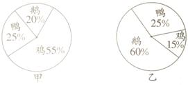

# Mathematics (Grade 6)

**ID**: dbbcc5ac
**难度**: medium
**题型**: multiple_choice

## 题目
甲、乙两个养殖户养的禽类统计图如下，两户养的鸭子数相比，(    )。

A．甲多
B．乙多
C．一样多
D．无法确定

## 解答

**答案**: D

1. Step1:观察甲、乙两个养殖户养的禽类统计图，发现图中仅给出了鸭子在各自养殖户中所占的比例，分别是甲户鸭子占25%，乙户鸭子占25%。
2. Step2:要比较两户养的鸭子数，需要知道鸭子的数量，而数量 = 总数×所占比例。
3. Step3:但两户养的禽类总数均未知，所以无法根据已知的比例确定鸭子的具体数量。
4. Step4:因此，两户养的鸭子数无法确定，答案选D。

## 知识点

**知识点**:
  - 小学数学;统计和概率;统计;统计图;扇形统计图的特点及绘制

---
