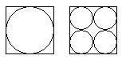

# Mathematics (Grade 6)

**ID**: dcdb70cc
**难度**: medium
**题型**: multiple_choice

## 题目
两张正方形硬纸板，一张剪去1个圆，一张剪去4个圆（如图）。哪一张剩下的废料多一些？

A．剪1个圆剩下的多
B．剪4个圆剩下的多
C．剩下的一样多

## 解答

**答案**: C

1. Step1:设正方形的边长为a。
2. Step2:计算剪去1个圆的废料面积，圆的半径为a/2，圆的面积为π×(a/2)² = πa²/4，正方形面积为a²，所以废料面积为a² - πa²/4。
3. Step3:计算剪去4个圆的废料面积，每个小圆的半径为a/4，4个小圆的总面积为4×π×(a/4)² = πa²/4，正方形面积为a²，所以废料面积为a² - πa²/4。
4. Step4:比较两种情况的废料面积，因为a² - πa²/4 = a² - πa²/4，所以剩下的废料一样多，答案选C。

## 知识点

**知识点**:
  - 小学数学;图形与几何;平面图形;圆;圆的面积

---
