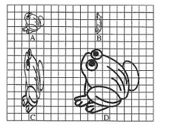

# Mathematics (Grade 6)

**ID**: ddba073b
**难度**: medium
**题型**: multiple_choice

## 题目
下图中图形（    ）是图形A按3：1放大后得到的图形。

## 解答

**答案**: B

1. Step1:明确按3：1放大图形是将各条边长按3：1放大，可通过长与高的长度比判断
2. Step2:观察图形A，确定其长与高的长度
3. Step3:分别观察图形B、C、D，确定它们的长与高的长度
4. Step4:分别计算图形B、C、D的长与高和图形A对应边的比
5. Step5:根据计算结果，找出长与高和图形A对应边的比为3：1的图形，即图形B

## 知识点

**知识点**:
  - 比例的应用;图形的放大与缩小

---
