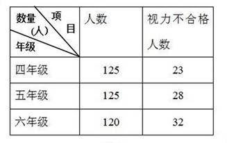

# Mathematics (Grade 6)

**ID**: df84478a
**难度**: medium
**题型**: multiple_choice

## 题目
下面是某校四至六年级学生视力情况统计表．

视力不合格人数最多的是（   ）
A．四年级
B．五年级
C．六年级

## 解答

**答案**: C

1. Step1:观察表格中四年级视力不合格人数为23人
2. Step2:观察表格中五年级视力不合格人数为28人
3. Step3:观察表格中六年级视力不合格人数为32人
4. Step4:比较23、28、32的大小，32＞28＞23
5. Step5:得出六年级视力不合格人数最多，答案选C

## 知识点

**知识点**:
  - 小学数学;统计和概率;统计;统计表

---
