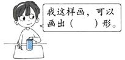

# Mathematics (Grade 6)

**ID**: e157c22f
**难度**: medium
**题型**: multiple_choice

## 题目
看图选出正确的选项。（   ）

A．长方
B．正方
C．圆

## 解答

**答案**: C

1. Step1:观察图片可知，图中人物是用圆柱物体画图形
2. Step2:因为圆柱底面是圆，所以这样画可以画出圆
3. Step3:对比选项，A选项长方、B选项正方均不符合，C选项圆符合，所以答案选C

## 知识点

**知识点**:
  - 

---
