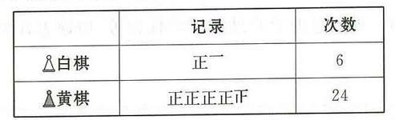

# Mathematics (Grade 6)

**ID**: e206bc1c
**难度**: medium
**题型**: multiple_choice

## 题目
下面是从纸袋中摸30次跳棋的结果（摸出一个棋子后，再放回去摇匀），纸袋中（   ）
   

    A．白棋数量多
    B．黄棋数量多
    C．白棋和黄棋数量一样多

## 解答

**答案**: B

1. Step1:明确已知条件为从纸袋中摸30次跳棋的结果，摸出一个棋子后再放回去摇匀
2. Step2:观察记录数据，白棋出现6次，黄棋出现24次
3. Step3:比较白棋和黄棋出现的次数，24大于6，即黄棋出现的次数多于白棋
4. Step4:根据摸球结果，在摸球次数足够多且摸完放回的情况下，出现次数多的棋子在纸袋中的数量相对较多，所以得出纸袋中黄棋数量多
5. Step5:对照选项，选择B选项

## 知识点

**知识点**:
  - 第四单元达标作业--

---
