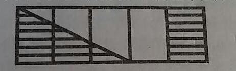

# Mathematics (Grade 6)

**ID**: e41e3443
**难度**: medium
**题型**: multiple_choice

## 题目
下图中阴影部分的面积占整个图形的(     )
$A.40\%$
$B.50\%$
$C.60\%$
$D.30\%$

## 解答

**答案**: B

1. Step1:观察图形可知，前三个小长方形中，三角形与空白部分面积相等
2. Step2:对于剩下部分，阴影和空白面积比为1:1
3. Step3:综合上述情况，可知阴影部分面积占整个图形面积的一半
4. Step4:将一半转化为百分数，即50%
5. Step5:对比选项，得出答案为B

## 知识点

**知识点**:
  - 

---
