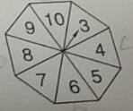

# Mathematics (Grade 6)

**ID**: e453fd83
**难度**: medium
**题型**: multiple_choice

## 题目
图中为一个转盘，转动转盘后，指针指向（    ）的可能性最小.
 A.奇数
 B.偶数
 C.小于5的数
 D.两位数

## 解答

**答案**: D

1. Step1:明确转盘中的数字分别为3、4、5、6、7、8、9、10
2. Step2:统计选项A奇数有3、5、7、9，共4个
3. Step3:统计选项B偶数有4、6、8、10，共4个
4. Step4:统计选项C小于5的数有3、4，共2个
5. Step5:统计选项D两位数只有10，共1个
6. Step6:比较各选项数字的个数，1＜2＜4，所以指针指向两位数的可能性最小

## 知识点

**知识点**:
  - 

---
