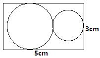

# Mathematics (Grade 6)

**ID**: e74e3b16
**难度**: medium
**题型**: multiple_choice

## 题目
在下图中，小圆的半径是（  ）厘米。

A．1.5
B．2.5
C．2
D．1

## 解答

**答案**: D

1. Step1:观察图形可知长方形的宽是3cm，也就是大圆和小圆的直径之和为3cm。
2. Step2:设小圆半径为r，大圆半径为R，且长方形的长为5cm，假设大圆与长方形的左边和上边相切，小圆与长方形的右边和上边相切，同时两圆相切，则有2R + 2r = 3，2R + r + r = 5 - R（从水平方向看两圆和长方形的位置关系）。
3. Step3:由2R + 2r = 3可得R + r = 1.5，即R = 1.5 - r。
4. Step4:把R = 1.5 - r代入2R + r + r = 5 - R中，得到2(1.5 - r) + 2r = 5 - (1.5 - r)。
5. Step5:展开式子得3 - 2r + 2r = 5 - 1.5 + r。
6. Step6:化简可得3 = 3.5 + r。
7. Step7:解得r = 1cm。

## 知识点

**知识点**:
  - 

---
