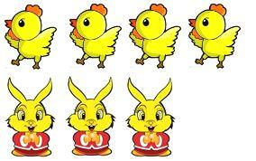

# Mathematics (Grade 6)

**ID**: e7e91a70
**难度**: medium
**题型**: multiple_choice

## 题目
小鸡和小兔谁多谁少？(  ) 

A．小鸡比小兔多
B．一样多
C．小兔比小鸡多

## 解答

**答案**: A

1. Step1:数出图中小鸡的数量为4只
2. Step2:数出图中小兔的数量为3只
3. Step3:比较4和3的大小，因为4>3，所以小鸡的数量比小兔多
4. Step4:根据比较结果，得出小鸡比小兔多，答案选A

## 知识点

**知识点**:
  - 小学数学;统计和概率;统计

---
