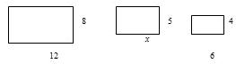

# Mathematics (Grade 6)

**ID**: e96a2a2b
**难度**: medium
**题型**: multiple_choice

## 题目
右面的图形是按一定的比例缩小的，x是(  )
A．10
B．8
C．7.5
D．6

## 解答

**答案**: C

1. Step1:根据图形按一定比例缩小，可知对应边成比例，即长与宽的比相等，得到比例式x：5 = 12：8
2. Step2:根据比例的基本性质“两内项之积等于两外项之积”，由x：5 = 12：8推出8x = 5×12
3. Step3:计算5×12的值为60，得到8x = 60
4. Step4:求解方程8x = 60，两边同时除以8，得出x = 60÷8 = 7.5

## 知识点

**知识点**:
  - 图形的放大与缩小．

---
