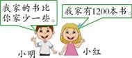

# Mathematics (Grade 6)

**ID**: e99845f1
**难度**: medium
**题型**: multiple_choice

## 题目
小明家可能有（  ）本书。

$\begin{description}
\item A．1285\item B．650\item C．1085
\end{description}$

## 解答

**答案**: C

1. Step1:已知小红家有1200本书，小明家的书比小红家少一些。
2. Step2:分析选项A，1285比1200多，不符合小明家书比小红家少一些的条件。
3. Step3:分析选项B，650比1200少很多。
4. Step4:分析选项C，1085比1200少一些，符合条件。
5. Step5:所以小明家可能有1085本书，答案选C。

## 知识点

**知识点**:
  - 小学数学;数与代数;数的认识;整数的认识

---
