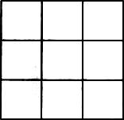

# Mathematics (Grade 6)

**ID**: e9af6414
**难度**: medium
**题型**: multiple_choice

## 题目
数一数，下图有(    )个正方形。

A．9
B．10
C．14

## 解答

**答案**: C

1. Step1:先数小正方形，图中边长为1个单位长度的小正方形有9个
2. Step2:再数由4个小正方形组成的稍大正方形，有4个
3. Step3:最后数由9个小正方形组成的最大正方形，有1个
4. Step4:将各类正方形数量相加，9 + 4 + 1 = 14个
5. Step5:对比选项，答案为C

## 知识点

**知识点**:
  - 小学数学;图形与几何;平面图形;长方形和正方形;正方形的概念及特点

---
