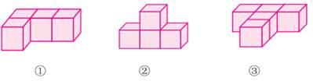

# Mathematics (Grade 6)

**ID**: eae0ee60
**难度**: medium
**题型**: multiple_choice

## 题目
观察下面三个物体，从前面看到的图形相同的是（     ）。

$\begin{description}
\item A．①和②\item B．①和③\item C．②和③
\end{description}$

## 解答

**答案**: B

1. Step1:观察物体①，从前面看是一层，有3个正方形并排；
2. Step2:观察物体②，从前面看是两层，下层3个正方形并排，上层中间有1个正方形；
3. Step3:观察物体③，从前面看是一层，有3个正方形并排；
4. Step4:对比发现物体①和③从前面看到的图形相同；
5. Step5:所以答案是B

## 知识点

**知识点**:
  - 小学数学;图形与几何;立体图形;观察物体

---
