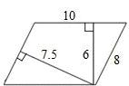

# Mathematics (Grade 6)

**ID**: eb1ee84a
**难度**: medium
**题型**: multiple_choice

## 题目
如图，计算平行四边形的面积，列式正确的是(  )

A．7.5×6
B．6×8
C．10×6
D．10×7.5

## 解答

**答案**: C

1. Step1:明确平行四边形面积公式为s = ah，其中a为底，h为高
2. Step2:观察图形，底为10时对应的高是6，此时面积可列式为10×6
3. Step3:底为8时对应的高是7.5，此时面积可列式为8×7.5
4. Step4:对比选项，发现C选项10×6符合面积列式

## 知识点

**知识点**:
  - 平行四边形的面积．

---
