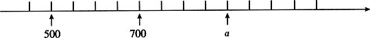

# Mathematics (Grade 6)

**ID**: ecfa489a
**难度**: medium
**题型**: multiple_choice

## 题目
下图中的a点表示的数是(    )。

A．900
B．905
C．950
D．105

## 解答

**答案**: A

1. Step1:观察数轴，发现从500到700之间间隔了4个小格
2. Step2:计算每个小格代表的数值，即(700 - 500)÷4 = 50
3. Step3:数出从700到a点间隔了4个小格
4. Step4:计算a点表示的数，700 + 50×4 = 900
5. Step5:对比选项，发现900对应的是A选项

## 知识点

**知识点**:
  - 小学数学;数与代数;数的认识;整数的认识

---
