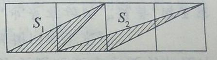

# Mathematics (Grade 6)

**ID**: eedbb8c8
**难度**: medium
**题型**: multiple_choice

## 题目
右图中两个三角形的面积关系是（  ）。
 A.
 $S_{1}>S_{2}$
 B.
 $S_{1}<S_{2}$
 C.
 $S_{1}=S_{2}$

## 解答

**答案**: C

1. Step1:根据三角形面积公式$三角形的面积=底×高÷2$，可知三角形面积大小由底和高决定
2. Step2:观察图中两个三角形，发现它们的底相等
3. Step3:观察图中两个三角形，发现它们的高也相等
4. Step4:因为两个三角形底和高都分别相等，所以根据面积公式可得它们的面积相等
5. Step5:对比选项，选择C

## 知识点

**知识点**:
  - 

---
