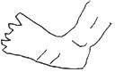

# Mathematics (Grade 6)

**ID**: f2cff125
**难度**: medium
**题型**: multiple_choice

## 题目
你的“脚掌”长（  ）
A．14厘米
B．10厘米左右
C．接近1米
D．50厘米

## 解答

**答案**: A

1. Step1:分析选项A，14厘米对于脚掌长度来说是比较合理的长度范围
2. Step2:分析选项B，10厘米左右对于正常成年人脚掌来说偏短
3. Step3:分析选项C，接近1米远远超出了正常脚掌长度，不符合实际
4. Step4:分析选项D，50厘米也远远超过了正常脚掌长度，不符合常理
5. Step5:综合比较，只有选项A符合脚掌长度的实际情况，所以答案是A

## 知识点

**知识点**:
  - 小学数学;图形与几何;测量;常见的长度单位及换算;长度及长度的常用单位

---
